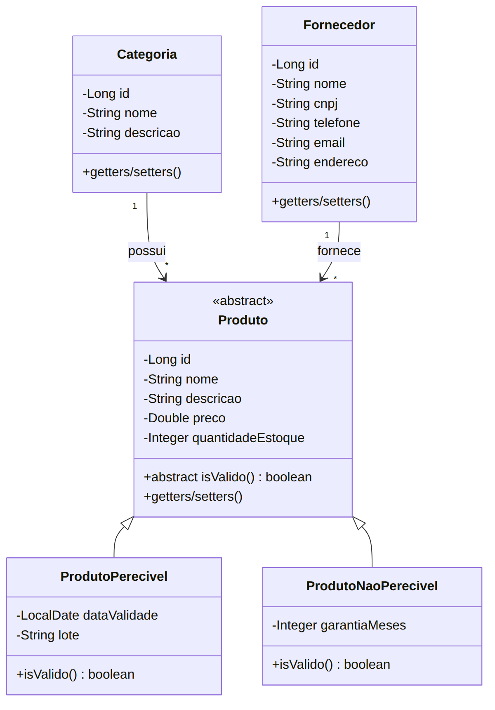
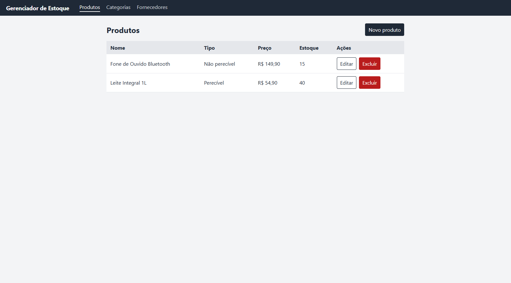
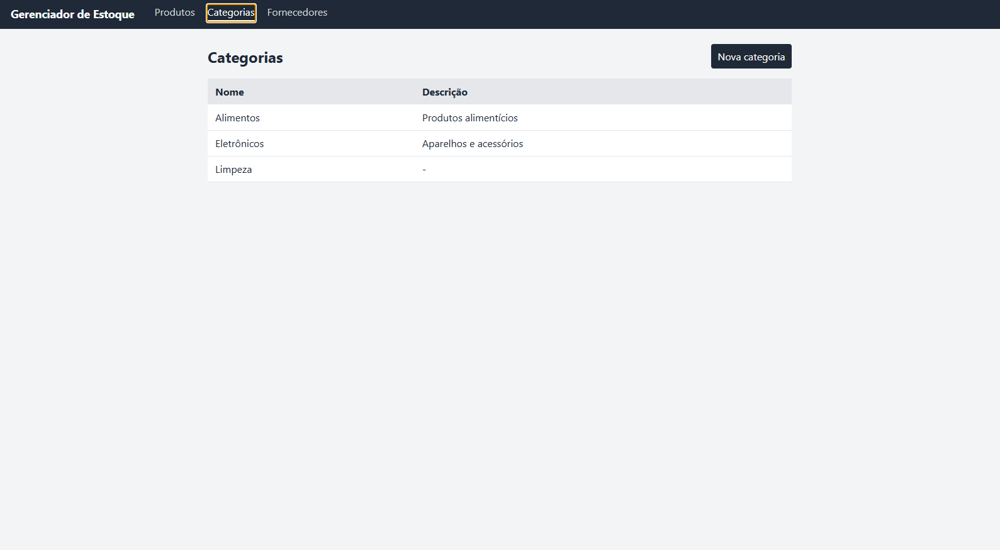
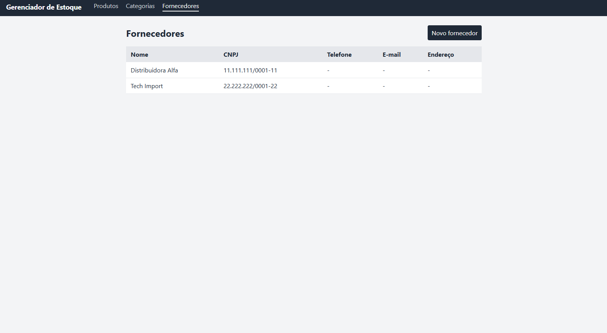

# Gerenciador de Estoque

Aplicação de gerenciamento de estoque com API Spring Boot, MySQL e interface React + TypeScript.

## Executar no Windows

1. Instale Docker Desktop e Node.js 20.19+ (ou 22.12+).
2. Execute [`iniciar-backend.bat`](./iniciar-backend.bat) e aguarde a mensagem de API pronta.
3. Execute [`iniciar-frontend.bat`](./iniciar-frontend.bat).
4. Abra `http://localhost:8082`. O backend fica em `http://localhost:8080`; o Swagger, em `http://localhost:8080/swagger-ui.html`.

O script do backend sobe somente o MySQL de desenvolvimento e a API. A importação de fornecedores CSV é processada diretamente pela API. Os dados do banco ficam nos volumes Docker. O frontend roda localmente com Vite, sem container.

Para encerrar o backend, no diretório `backend`, execute `docker compose down`. Para encerrar o frontend, use `Ctrl+C` na janela do servidor.

## Funcionalidades

Para manter o foco, o escopo foi reduzido ao núcleo do domínio:

- **Produtos**: listar, cadastrar, editar e excluir por meio da API persistida.
- **Categorias**: listar e cadastrar categorias usadas pelos produtos.
- **Fornecedores**: listar, cadastrar e importar CSV de forma síncrona.
- **Interface React**: React Router, TanStack Query, Context API para a sessão demonstrativa, formulários controlados e estados de carregamento/erro.

O acesso pelo formulário de entrada é apenas uma demonstração de rota protegida no navegador. **Não é autenticação e não protege os endpoints da API.**

O frontend usa `http://localhost:8080/com/api` como endereço padrão da API. Para outro endereço, crie `frontend/.env.local` com:

```env
VITE_API_BASE_URL=http://localhost:8080/com/api
```


## Modelo de domínio


Pontos principais do modelo:

- `Produto` é uma classe abstrata, com dois tipos:
  - `ProdutoPerecivel`: possui `dataValidade` e `lote`.
  - `ProdutoNaoPerecivel`: possui `garantiaMeses`.
- Uma `Categoria` possui vários produtos (1 para N).
- Um `Fornecedor` fornece vários produtos (1 para N).

> **Consequência para a interface:** o formulário de produto deve exibir campos diferentes conforme o tipo escolhido (validade e lote para perecível, garantia para não perecível).

## Telas de concepção

### Tela 1



### Tela 2



### Tela 3



## Contratos principais da API

- Produtos: `/com/api/produtos` (CRUD).
- Categorias: `/com/api/categorias` (listagem e cadastro).
- Fornecedores: `/com/api/fornecedores` (listagem e cadastro).
- Importação síncrona: `PUT /com/api/fornecedores/importacao` com multipart field `arquivo`. A resposta informa quantos fornecedores foram inseridos e quantos duplicados foram ignorados.

As tabelas são criadas pelo script `backend/mysql/init-dev.sql`; o Hibernate não gera o schema automaticamente. No primeiro início, aguarde o MySQL executar o script de inicialização.