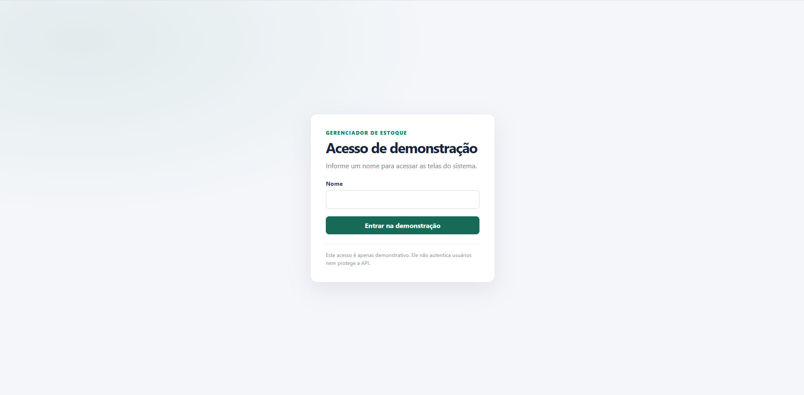
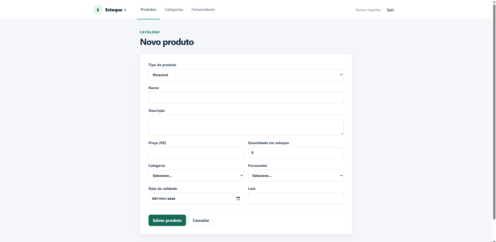
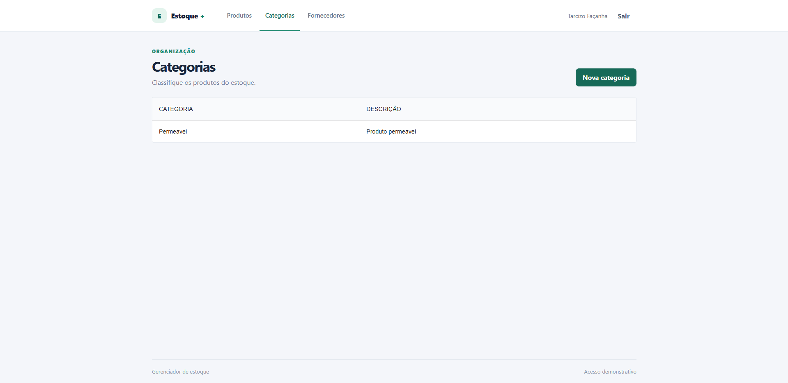
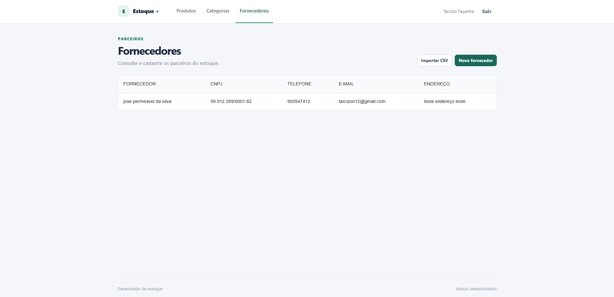

# Gerenciador de Estoque

## 1. Título do projeto

**Gerenciador de Estoque** — aplicação web para organizar produtos, categorias e fornecedores.

## 2. Objetivo do projeto

O projeto oferece uma interface para manter um catálogo de produtos e suas informações de estoque, relacionando cada produto a uma categoria e a um fornecedor. Também permite cadastrar fornecedores individualmente ou importar seus dados a partir de um arquivo CSV. A API valida e persiste os registros em MySQL.

## 3. Features implementadas

- **Produtos:** listar, cadastrar, editar e excluir produtos. O modelo diferencia produtos perecíveis (validade e lote) e não perecíveis (meses de garantia).
- **Categorias:** listar e cadastrar categorias para classificar os produtos.
- **Fornecedores:** listar e cadastrar fornecedores, além de importar CSV de forma síncrona. A resposta da API informa quantos registros foram criados e quantos duplicados foram ignorados.
- **Consulta externa de CEP:** o formulário de fornecedor usa Fetch API e ViaCEP para preencher o endereço, tratando estados de consulta e erros.
- **Interface reativa:** formulários controlados, tabelas, confirmação de exclusão e estados visíveis de carregamento, sucesso e erro.
- **Estado global:** Redux Toolkit armazena a sessão demonstrativa; TanStack Query mantém cache e sincroniza dados da API REST.
- **Navegação:** páginas distintas com React Router. O acesso inicial por nome é uma proteção demonstrativa do frontend, não uma autenticação.
- **Persistência e validação:** API REST em Spring Boot, regras de domínio e persistência relacional em MySQL.

> A rota de entrada demonstrativa não autentica o usuário e não protege os endpoints da API.

## 4. Tecnologias utilizadas

- **Frontend:** React 18, TypeScript, Create React App, React Router, Redux Toolkit, TanStack Query, Material UI, Fetch API e CSS.
- **Backend:** Java 21, Spring Boot, Spring Web, Spring Validation, Spring Data JPA, OpenFeign e Springdoc OpenAPI.
- **Dados:** MySQL 8.4.
- **Ambiente conteinerizado:** Docker, Docker Compose, Node.js 22 e Nginx para servir o build estático do frontend.
- **Testes:** Jest, JUnit 5, Mockito e Spring Boot Test.

## 5. Instruções de execução

### Preparação e verificação dos critérios React

O frontend usa Create React App. Para conferir a estrutura, Redux, integração externa e uma checagem manual em navegadores diferentes, consulte os exemplos e comandos em [`frontend/README.md`](./frontend/README.md). Os testes automatizados do frontend usam apenas Jest, incluído no Create React App.

### Requisitos

- Docker instalado e em execução. No Windows, use o Docker Desktop; no Linux, Docker Engine e o plugin Docker Compose; no macOS, Docker Desktop. Os scripts `.sh` também requerem Bash e `curl`.
- Git, para clonar o repositório.
- Não é necessário instalar Node.js ou Java no computador para a execução via scripts Docker. Para desenvolvimento local sem Docker, veja os READMEs de [backend](./backend/README.md) e [frontend](./frontend/README.md).

### Subir a aplicação

1. Clone o repositório:

   ```powershell
   git clone https://github.com/tarcizo12/Desenvolvimento-de-aplicacoes-Interativas-com-React-26E4_2-.git
   cd Desenvolvimento-de-aplicacoes-Interativas-com-React-26E4_2-
   ```

2. Inicie o Docker Desktop e aguarde até que ele esteja pronto.
3. Para iniciar tudo de uma vez, execute [`scripts/iniciar-tudo.bat`](./scripts/iniciar-tudo.bat). Ele inicia o backend e o banco, aguarda a API responder e depois inicia o frontend. Se preferir, execute separadamente [`iniciar-backend.bat`](./scripts/windows/iniciar-backend.bat) e [`iniciar-frontend.bat`](./scripts/windows/iniciar-frontend.bat).
4. Acesse:
   - Aplicação: [http://localhost:8082](http://localhost:8082)
   - API: [http://localhost:8080](http://localhost:8080)
   - Swagger: [http://localhost:8080/swagger-ui.html](http://localhost:8080/swagger-ui.html)

Cada parte possui sua própria configuração Compose: [`backend/docker-compose.yml`](./backend/docker-compose.yml) para API e bancos, e [`frontend/docker-compose.yml`](./frontend/docker-compose.yml) para a interface. Assim, é possível construir, iniciar ou atualizar uma parte sem recriar a outra. A primeira execução baixa as imagens-base e compila as aplicações, podendo levar alguns minutos. O frontend é servido em um container Nginx e chama a API em `http://localhost:8080/com/api`. Para usar outro endereço, defina `REACT_APP_API_BASE_URL` antes de construir a imagem; essa variável é aplicada no build do frontend.

### Linux e macOS

Os scripts multiplataforma estão organizados por sistema na pasta [`scripts/`](./scripts/): `scripts/windows/` contém os arquivos `.bat` e `scripts/linux/` contém os equivalentes `.sh`. Os scripts localizam a raiz do projeto automaticamente, portanto podem ser executados a partir de qualquer diretório.

No Linux, a partir da raiz do repositório, torne os scripts executáveis uma vez:

```bash
chmod +x scripts/*.sh scripts/linux/*.sh
```

Depois execute o script combinado para subir backend/banco e frontend em sequência:

```bash
./scripts/iniciar-tudo.sh
```

O banco de desenvolvimento é iniciado automaticamente como dependência da API. O frontend também pode ser iniciado sozinho, mas precisa da API para operações de dados. Os scripts imprimem os endereços quando os serviços respondem: interface em `http://localhost:8082`, API em `http://localhost:8080`.

O script combinado reutiliza as rotinas em `scripts/linux/` e para caso o backend não inicie. Para subir cada parte separadamente, execute `./scripts/linux/iniciar-backend.sh` e depois `./scripts/linux/iniciar-frontend.sh`.

No macOS, os mesmos comandos `.sh` funcionam se o Docker Desktop e o shell Bash estiverem disponíveis. Como alternativa, se o checkout não preservar a permissão de execução, invoque cada script com `bash`, por exemplo `bash scripts/linux/iniciar-backend.sh`.

Para acompanhar logs manualmente, use `docker compose logs -f` dentro de `backend/` ou `frontend/`, conforme o serviço.

### Encerrar ou recomeçar

No Windows, execute [`parar-aplicacao.bat`](./scripts/windows/parar-aplicacao.bat) para encerrar frontend, API e bancos. Por padrão, o script preserva os volumes MySQL. Confirme a opção de apagar volumes somente se quiser excluir os dados e inicializar os bancos do zero.

No Linux ou macOS, execute o script equivalente:

```bash
./scripts/linux/parar-aplicacao.sh
```

O script pergunta se deseja apagar os volumes do banco. Responda `n` (ou apenas pressione Enter) para preservá-los; responda `s` apenas se quiser excluir permanentemente os dados e reiniciar com bancos vazios.

Os bancos de desenvolvimento e produção usam volumes separados. A aplicação inicia o ambiente de desenvolvimento. As tabelas são criadas pelo script [`init-dev.sql`](./backend/mysql/init-dev.sql) no primeiro início do volume.

### Endpoints principais

- Produtos: `/com/api/produtos` (CRUD).
- Categorias: `/com/api/categorias` (listagem e cadastro).
- Fornecedores: `/com/api/fornecedores` (listagem e cadastro).
- Importação: `PUT /com/api/fornecedores/importacao`, multipart field `arquivo`.

## 6. Repositório GitHub

[tarcizo12/Desenvolvimento-de-aplicacoes-Interativas-com-React-26E4_2-](https://github.com/tarcizo12/Desenvolvimento-de-aplicacoes-Interativas-com-React-26E4_2-)

## 7. Screenshots e demonstração

As telas abaixo foram adicionadas ao repositório como imagens de referência da interface:

### Acesso demonstrativo



### Listagem de produtos


### Formulário de produto



### Categorias



### Fornecedores



### Modelo de dados


## 8. Considerações finais

O desenvolvimento reuniu uma interface React com formulários e navegação, uma API REST com persistência relacional e um processo Docker Compose para facilitar a execução completa. Entre os desafios estiveram alinhar os contratos entre frontend e backend, validar dados antes de persistir e deixar os serviços simples de iniciar em um ambiente de avaliação.

O projeto aplica conceitos de componentes, hooks, Context API, requisições assíncronas com tratamento de erros, rotas protegidas demonstrativas, serviços REST e modelagem com herança. A autenticação real e a proteção de API não fazem parte do escopo atual.
